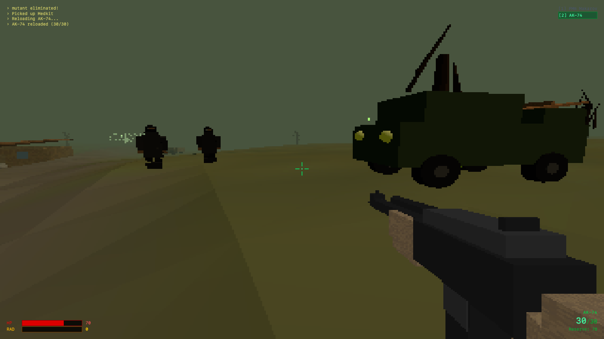

# S.T.A.L.K.E.R. 64

A browser-based first-person shooter inspired by the S.T.A.L.K.E.R. series, built with Three.js and React. Experience the Zone in retro N64-style graphics with procedurally generated assets.



## Features

- **Retro N64 Aesthetic**: Low-resolution rendering with pixelated graphics and atmospheric fog
- **Procedural Generation**: All textures, models, and sounds generated in code - no external assets
- **Three-Way Faction AI**: Bandits, Mutants, and Friendly Stalkers with dynamic combat
- **Weapon System**: PMm Makarov pistol and AK-74 assault rifle with realistic mechanics
- **Inventory System**: Full PDA-style inventory with equipment slots and item stacking
- **Radiation & Anomalies**: Explore radioactive zones, collect artifacts, manage radiation exposure
- **Open World**: 300x300m map with villages, vehicles, and dynamic encounters

## Controls

### Keyboard & Mouse

| Action | Key/Button |
|--------|-----------|
| Move | W/A/S/D |
| Look/Aim | Mouse |
| Sprint | Shift |
| Crouch | C |
| Fire | Left Mouse Button |
| Reload | R |
| Pick Up / Interact | E or F |
| Switch to Makarov | 1 |
| Switch to AK-74 | 2 |
| Open Inventory | I or Tab |

### Gamepad (PlayStation/Xbox)

| Action | PlayStation | Xbox |
|--------|-------------|------|
| Move | Left Stick | Left Stick |
| Look/Aim | Right Stick | Right Stick |
| Fire | R2 | RT |
| Sprint | L2 | LT |
| Pick Up / Use Item | ✕ (Cross) | A |
| Crouch | ○ (Circle) | B |
| Reload | □ (Square) | X |
| Open Inventory | △ (Triangle) or Touchpad | Y or View |
| Switch Weapon | L1 | LB |
| Quick Heal (Medkit) | R1 | RB |

## Gameplay Tips

- **Explore Houses**: Buildings have open doorways - walk inside to find loot
- **Manage Radiation**: Stay out of green anomaly zones or use Anti-Rad items
- **Artifacts**: Found in radiation zones, equip them for passive bonuses
- **Friendly Stalkers**: Yellow-suited NPCs will help you fight enemies
- **Ammo Stacking**: Ammo items stack up to 999 per inventory slot
- **Quick Heal**: Press R1/RB on gamepad to instantly use a medkit

## Technology Stack

- **Three.js**: 3D rendering and game engine
- **React**: UI components and state management
- **TypeScript**: Type-safe development
- **Tailwind CSS**: HUD and inventory styling
- **Web Audio API**: Procedural sound effects

## Development

```bash
# Install dependencies
npm install

# Run development server
npm run dev

# Build for production
npm run build
```

## Deployment to GitHub Pages

To deploy this game to GitHub Pages, you need to configure the base path:

1. Open `vite.config.js`
2. Add the `base` option with your repository name:

```javascript
export default defineConfig({
  base: '/your-repo-name/',  // Add this line
  plugins: [react(), tailwindcss()],
  // ... rest of config
});
```

3. Build the project:
```bash
npm run build
```

4. Deploy the `dist` folder to your GitHub Pages branch

### Alternative: GitHub Actions

Create `.github/workflows/deploy.yml`:

```yaml
name: Deploy to GitHub Pages

on:
  push:
    branches: [ main ]

jobs:
  deploy:
    runs-on: ubuntu-latest
    steps:
      - uses: actions/checkout@v3
      
      - name: Setup Node
        uses: actions/setup-node@v3
        with:
          node-version: '18'
      
      - name: Install dependencies
        run: npm ci
      
      - name: Build
        run: npm run build
        env:
          BASE_URL: /${{ github.event.repository.name }}/
      
      - name: Deploy
        uses: peaceiris/actions-gh-pages@v3
        with:
          github_token: ${{ secrets.GITHUB_TOKEN }}
          publish_dir: ./dist
```

## Browser Compatibility

- Modern browsers with WebGL support
- Recommended: Chrome, Firefox, Safari, Edge (latest versions)
- Gamepad API support for controller input

## License

This project is created for educational and entertainment purposes.

## Credits

Inspired by the S.T.A.L.K.E.R. game series by GSC Game World.

---

**Enter the Zone. Survive. Thrive.**
